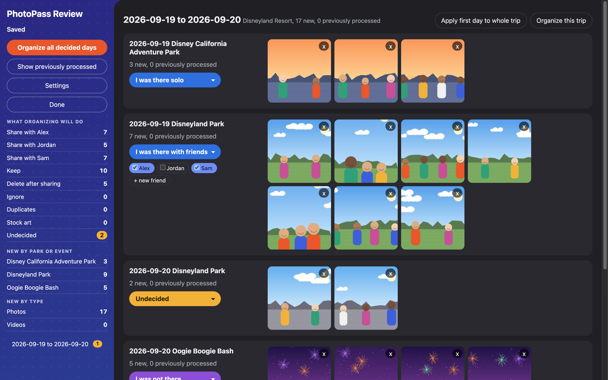
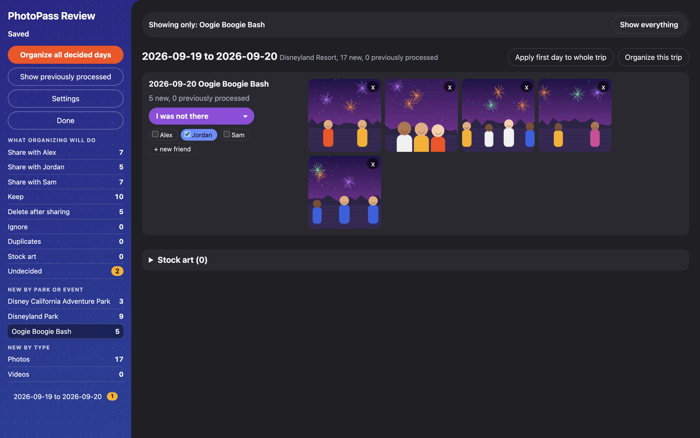
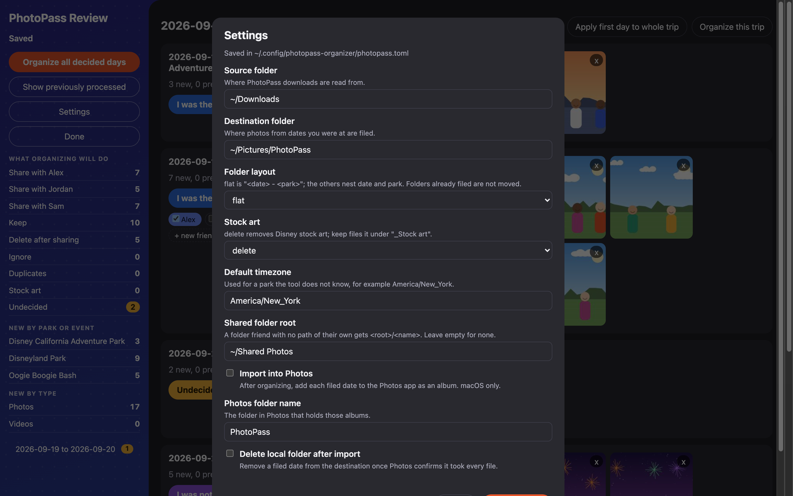

# photopass-organizer

Your Disney PhotoPass photos, sorted the way you remember the trip.

Download your whole gallery with one click and let photopass-organizer do the rest. It files each new
photo under the day and park where it was taken, gives your friends their copies, and sets aside
everything you have already sorted.

## What you get

- **One-click downloads.** Use "Select all visible media" every time. The tool remembers each photo it has
  seen, so only your new photos are waiting for you, with no picking them out by hand.
- **Every photo on the right day.** The tool reads the real capture time, so the evening fireworks are
  filed under the night you watched them, not the day after. Ride videos join the photos they were taken
  with.
- **A tidy folder for each day and park.** Choose the layout you like: by date, by park, or one folder per
  day and park. On a Mac, each day can go straight into its own album in Photos.
- **Sharing that takes care of itself.** Say which friends were with you, and each one gets copies in a
  synced folder or a shared Photos album. Nobody is sent the same photo twice.
- **Special events get their own place.** Photos from a ticketed event, such as a Halloween party, are
  filed under the name of the event.
- **Only the photos of you, your friends and your family.** The stock art that comes with each download
  is cleared away, and one click keeps a picture you want.
- **A review page that makes it quick.** See your new photos by trip and day in your browser, choose who
  was there, filter by park, friend or type, and click "Organize". The page runs on your own computer,
  not on a website.
- **Safe by design.** Preview a run before it happens, and nothing is removed until its copies are safely
  in place. Your choices are kept in one plain text file that you can read and edit.

## The review page

Everything happens on one page in your browser. The pictures below use drawn sample photos.



Choose who was there for each day, select the friends who get copies, and click "Organize". The totals on
the left show what will happen before you start.



Click a total to see only those photos: one park or event, one friend, or only the days still to decide.



Change where photos come from and where they go on the Settings form, with no file to edit.

## Quick start

photopass-organizer runs on macOS and Linux and needs Python 3.12 or newer. The Photos.app features work
on macOS only.

1. Install the tool:

   ```sh
   uv tool install git+https://github.com/SnoElement/photopass-organizer
   ```

   `pipx install` takes the same address, and Homebrew users can run
   `brew install snoelement/tap/photopass-organizer`.

2. Write a starter configuration, then check its settings:

   ```sh
   photopass-organizer init
   ```

3. Download your photos from PhotoPass into `~/Downloads`.
4. Open the review page:

   ```sh
   photopass-organizer review
   ```

5. Make a choice for each day, then click "Organize all decided days".

The [how-to](docs/how-to.md) gives each of these steps in full.

## Documentation

- [How to use photopass-organizer](docs/how-to.md): install, first run, the routine for each download,
  sharing with friends, and getting back a photo that was deleted by mistake.
- [How photopass-organizer works](docs/how-it-works.md): what a PhotoPass download contains, how dates,
  duplicates and stock art are recognised, and what gets deleted and when.
- [Reference](docs/reference.md): every setting and rule in `photopass.toml`, the commands, the state
  files and the platform notes.

## Development

```sh
git clone https://github.com/SnoElement/photopass-organizer.git
cd photopass-organizer
uv sync
uv run pytest
uv run ruff check .
uv run ruff format .
```

Tests and documentation use invented names (Alex, Sam, Jordan). `tests/test_scrub.py` fails if a listed
private name or a home directory path appears in a tracked file; the list is read from
`private-names.txt` in the state directory, and the test is skipped when that file does not exist.
See `CONTRIBUTING.md` for the pull request conventions.

## License and trademarks

photopass-organizer is released under the MIT license; see `LICENSE`. It is not affiliated with The Walt
Disney Company. PhotoPass is a trademark of Disney Enterprises, Inc.
